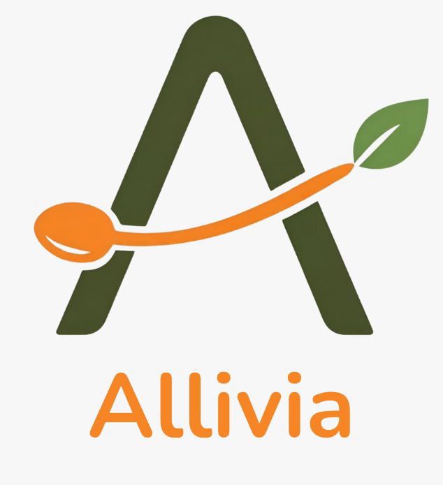
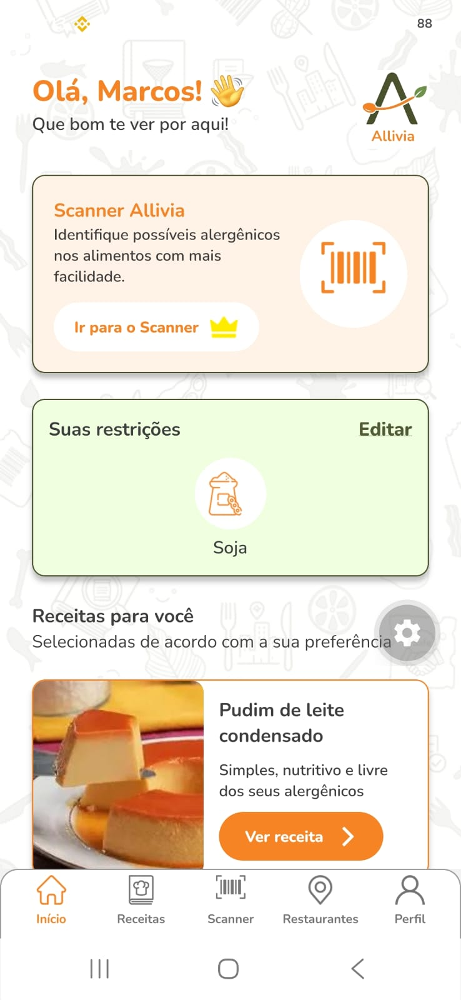
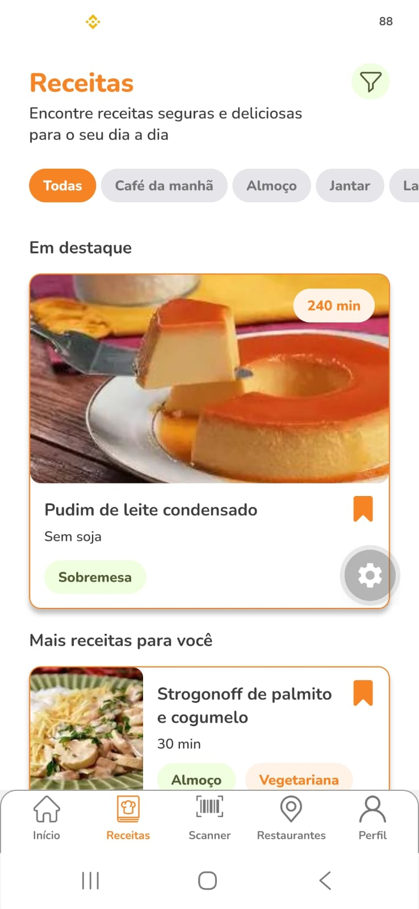
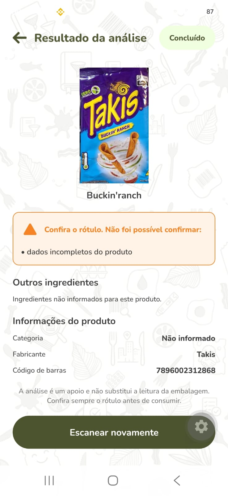
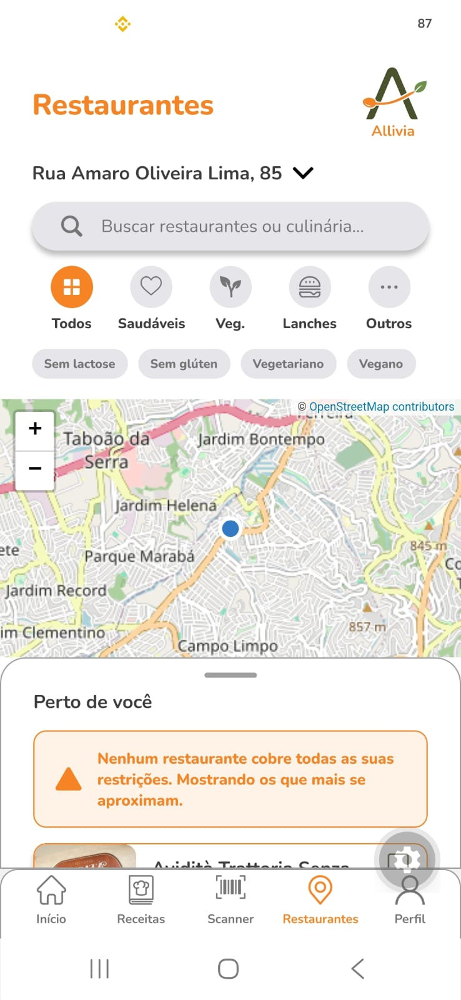

<p align="center">
  
</p>

<h1 align="center">Allivia</h1>

<p align="center"><strong>Segurança em cada refeição.</strong></p>

<p align="center">
  Aplicativo mobile que ajuda pessoas com alergias e restrições alimentares a se alimentarem com mais segurança.<br>
  Projeto de Trabalho de Conclusão de Curso – Técnico em Desenvolvimento de Sistemas – Etec de Taboão da Serra.
</p>

---

## Sumário

1. [Sobre o projeto](#sobre-o-projeto)
2. [Demonstração](#demonstração)
3. [Funcionalidades](#funcionalidades)
4. [Tecnologias](#tecnologias)
5. [Estrutura do repositório](#estrutura-do-repositório)
6. [Como executar](#como-executar)
7. [Documentação](#documentação)
8. [Testes](#testes)
9. [Aviso de segurança alimentar](#aviso-de-segurança-alimentar)
10. [Equipe](#equipe)
11. [Licença](#licença)

## Sobre o projeto

O Allivia reúne, em um só aplicativo, o que uma pessoa com alergia alimentar precisa no dia a dia. O usuário informa suas alergias e preferências uma única vez e, a partir disso, o aplicativo:

- mostra **receitas** que já excluem os alergênicos do seu perfil;
- analisa **produtos pelo código de barras** e indica se contêm, podem conter ou não apresentam alergênicos do perfil;
- indica **restaurantes** que atendem às suas restrições, ordenados pela distância.

O princípio que guia todas as decisões do projeto é simples: **em caso de dúvida, o aplicativo responde "atenção", nunca "seguro".**

## Demonstração

▶️ **Vídeo de demonstração:** [assista no YouTube](https://youtu.be/91AB24_cSzw) ou baixe o arquivo em [`videos/demonstracao-allivia.mp4`](videos/demonstracao-allivia.mp4).

<p align="center">
  
  
  
  
</p>

Todas as telas estão em [`imagens/telas/`](imagens/telas/).

## Funcionalidades

| Módulo | O que o usuário pode fazer |
| --- | --- |
| Acesso e cadastro | Criar conta com aceite dos Termos de Uso e da Política de Privacidade, confirmar o e-mail com código de 6 dígitos, entrar, recuperar a senha |
| Perfil alimentar | Informar nome, alergias do catálogo (8 alergênicos), até 5 alergias personalizadas e preferências (sem lactose, sem glúten, vegetariana, vegana) |
| Receitas | Listar receitas compatíveis com o perfil, filtrar por refeição, tempo, dieta e ingredientes, abrir a receita com aviso de segurança e salvar favoritas |
| Scanner (Premium) | Ler o código de barras pela câmera ou digitá-lo, ver a análise do produto e consultar o histórico de produtos escaneados |
| Restaurantes | Buscar restaurantes perto da localização atual ou de um endereço, ver no mapa, abrir detalhes e fotos, salvar e abrir a rota |
| Perfil e conta | Editar nome, foto, e-mail, senha e restrições, ler Termos, Privacidade e Ajuda, sair e excluir a conta |
| Premium (simulado) | Escolher o plano mensal ou anual e concluir uma assinatura **fictícia**: nenhuma cobrança é feita e nenhum dado de cartão é armazenado ou enviado |

## Tecnologias

| Camada | Tecnologia |
| --- | --- |
| Aplicativo | React Native com Expo (SDK 58) e Expo Router |
| Linguagem | TypeScript em modo estrito |
| Back-end | Supabase: autenticação, PostgreSQL com RLS, funções SQL e Storage |
| Estado | TanStack Query (dados remotos) e Zustand (estado local) |
| Scanner | expo-camera e API pública Open Food Facts |
| Mapas | OpenStreetMap com Leaflet (via react-native-webview) e expo-location |
| Qualidade | ESLint, Prettier, Jest e React Native Testing Library |
| Design | Figma |

## Estrutura do repositório

```
Projeto
├── README.md              apresentação do projeto (este arquivo)
├── LICENSE                licença de uso (todos os direitos reservados)
├── .gitignore             arquivos que não vão para o Git
├── docs/
│   ├── requisitos.md      requisitos funcionais, não funcionais e regras de negócio
│   ├── arquitetura.md     tecnologias, camadas, pastas e decisões técnicas
│   ├── banco-de-dados.md  modelo de dados, tabelas, regras de acesso e funções
│   ├── testes.md          política de testes, casos de teste e resultados
│   ├── manual-usuario.md  guia de uso do aplicativo
│   └── anexos/            planilha de casos de teste e política de testes originais
├── imagens/
│   ├── logo/              logotipo do Allivia
│   ├── diagramas/         diagramas do sistema
│   └── telas/             capturas das telas do aplicativo
├── videos/                vídeo de demonstração (também no YouTube)
└── codigo-fonte/          código-fonte do aplicativo (Expo)
```

## Como executar

Pré-requisitos: Node.js (versão LTS), Git e o aplicativo **Expo Go** no celular, conectado à mesma rede Wi-Fi do computador.

```bash
# 1. Clonar o repositório
git clone <endereço-deste-repositório>
cd <pasta-do-repositório>/codigo-fonte

# 2. Instalar as dependências
npm install

# 3. Criar o arquivo .env a partir do modelo e preencher as chaves públicas do Supabase
cp .env.example .env

# 4. Iniciar o servidor de desenvolvimento e ler o QR code com o Expo Go
npx expo start
```

No Windows (PowerShell), use `npm.cmd install` e `npm.cmd start -- --clear`. Se a rede bloquear a conexão local, use `npm.cmd start -- --tunnel`.

A configuração do banco de dados e a geração do APK estão descritas em [`codigo-fonte/README.md`](codigo-fonte/README.md) e em [`docs/banco-de-dados.md`](docs/banco-de-dados.md).

## Documentação

| Documento | Conteúdo |
| --- | --- |
| [Requisitos](docs/requisitos.md) | Requisitos funcionais e não funcionais, regras de negócio e escopo |
| [Arquitetura](docs/arquitetura.md) | Tecnologias, camadas, organização do código, fluxo de dados e decisões técnicas |
| [Banco de dados](docs/banco-de-dados.md) | Diagrama entidade-relacionamento, dicionário de dados, RLS e funções |
| [Testes](docs/testes.md) | Política de testes, 57 casos de teste, resultados e falhas registradas |
| [Manual do usuário](docs/manual-usuario.md) | Passo a passo de cada funcionalidade do aplicativo |

## Testes

Foram planejados e executados **57 casos de teste** (unidade, integração e sistema), distribuídos em 10 módulos: **55 aprovados** e **2 falhas registradas** (lentidão transitória no carregamento do mapa e ausência de modelos de e-mail na suíte automatizada). Os detalhes estão em [`docs/testes.md`](docs/testes.md) e os documentos originais em [`docs/anexos/`](docs/anexos/).

Para rodar as verificações automatizadas, na pasta `codigo-fonte/`:

```bash
npm run check   # TypeScript, ESLint e Jest em sequência
```

## Aviso de segurança alimentar

> O Allivia é uma ferramenta de apoio. Ele **não substitui a leitura do rótulo** nem a **orientação de profissionais de saúde**. Sempre confira os ingredientes e, em restaurantes, confirme as informações sobre alergênicos e contaminação cruzada com o estabelecimento.

## Equipe

**Etec de Taboão da Serra** – Técnico em Desenvolvimento de Sistemas

- Lavínia Manzan
- Mirella Ferreira
- Rihana Ferreira
- Sophia Félix
- Vicente da Silva

Contato: [alliviafood@gmail.com](mailto:alliviafood@gmail.com)

## Licença

Projeto acadêmico e autoral. **Todos os direitos reservados** à equipe Allivia: o uso, a cópia, a modificação e a distribuição são exclusivos dos autores. É permitida apenas a consulta para fins de avaliação acadêmica. Consulte o arquivo [LICENSE](LICENSE).
