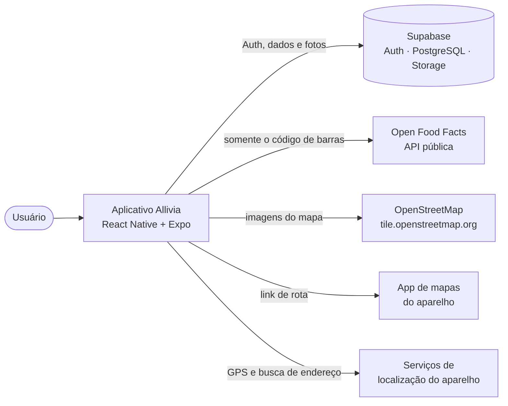
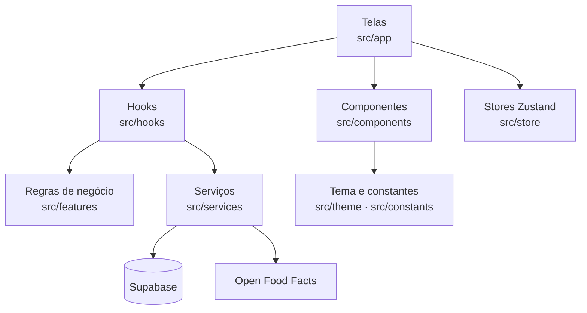
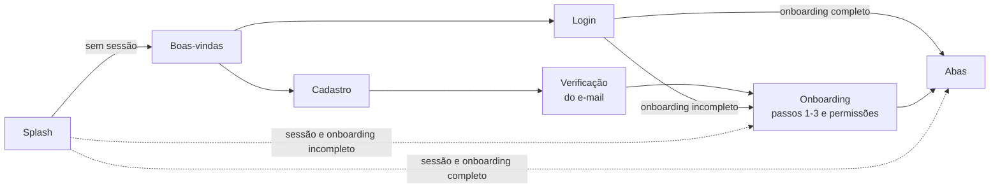
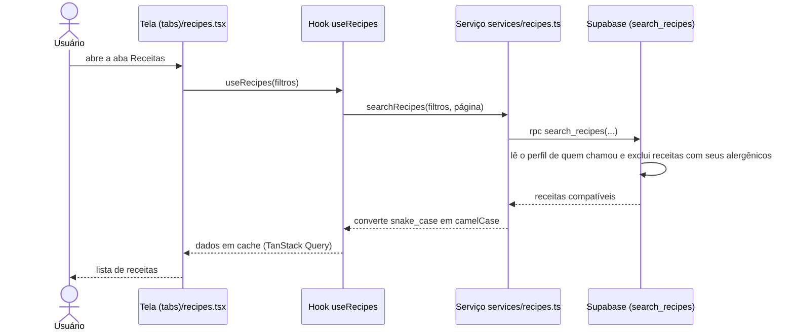

# Arquitetura do Sistema – Allivia

**Instituição:** Etec de Taboão da Serra
**Integrantes:** Lavínia Manzan, Mirella Ferreira, Rihana Ferreira, Sophia Félix e Vicente da Silva

---

## 1 Visão geral

O Allivia é um aplicativo mobile escrito em **TypeScript** com **React Native** sobre o **Expo**. Não há servidor próprio: o back-end é o **Supabase**, que fornece autenticação, banco de dados PostgreSQL, regras de acesso por linha (RLS), funções SQL e armazenamento de arquivos. As regras sensíveis, como o bloqueio de receitas por alergia, ficam no próprio banco.



*Figura 1 – Contexto do sistema. Fonte: autoria própria (2026).*

## 2 Tecnologias

| Finalidade | Tecnologia | Versão |
| --- | --- | --- |
| Plataforma | Expo SDK | 58 |
| Interface | React Native / React | 0.88 / 19.3 |
| Linguagem | TypeScript (modo estrito) | 6.0 |
| Navegação | Expo Router (rotas por arquivo) | 58 |
| Back-end | Supabase (`@supabase/supabase-js`) | 2 |
| Dados remotos | TanStack Query | 5 |
| Estado local | Zustand | 5 |
| Sessão salva | expo-sqlite (`localStorage`) | 58 |
| Scanner | expo-camera e expo-haptics | 58 |
| Fotos de perfil | expo-image-picker e expo-image | 58 |
| Localização | expo-location | 58 |
| Mapa | Leaflet 1.9.4 com OpenStreetMap, exibido por react-native-webview | 14.0 |
| Fonte de produtos | Open Food Facts (API v2) | — |
| Tipografia | Nunito (`@expo-google-fonts/nunito`) | — |
| Qualidade | ESLint, Prettier, Jest, React Native Testing Library | 9 / 3 / 30 / 14 |
| Build Android | EAS Build (APK `preview` e AAB `production`) | — |
| Design | Figma | — |

As versões exatas estão em [`codigo-fonte/package.json`](../codigo-fonte/package.json).

## 3 Arquitetura em camadas

O aplicativo é organizado em camadas, e cada camada só conversa com a camada de baixo. **Nenhuma tela chama uma API ou o cliente do Supabase diretamente.**



*Figura 2 – Camadas do aplicativo. Fonte: autoria própria (2026).*

| Camada | Pasta | Responsabilidade |
| --- | --- | --- |
| Telas | `src/app/` | Uma rota por arquivo (Expo Router); montam a tela com componentes e hooks |
| Componentes | `src/components/` | `ui/` (design system: botões, campos, cards, chips, modais, tab bar) e componentes de domínio (`recipes/`, `restaurants/`, `premium/`, `feature/`) |
| Hooks | `src/hooks/` | Buscas com TanStack Query: receitas, produto, restaurantes, mapa e Premium |
| Regras | `src/features/` | Funções puras e testadas: autenticação, onboarding, filtros, análise do scanner, distância, planos |
| Estado local | `src/store/` | Sessão, perfil, filtros de receitas e localização escolhida |
| Serviços | `src/services/` | Única camada que fala com sistemas externos; converte `snake_case` do banco em `camelCase` |
| Tema | `src/theme/` | Tokens do Figma: cores, tipografia, espaçamentos, raios e sombras |
| Constantes | `src/constants/` | Catálogo de alergênicos, preferências, textos da interface e chaves de funcionalidade |
| Utilitários | `src/utils/` | Validadores, segurança da receita, saneamento de texto e limite de tempo |

## 4 Organização das pastas

```
codigo-fonte/
├── src/
│   ├── app/                rotas e telas
│   │   ├── (auth)/         boas-vindas, login, cadastro, verificação de e-mail, recuperação de senha
│   │   ├── (onboarding)/   passos 1 a 3 e permissões
│   │   ├── (tabs)/         Início, Receitas, Scanner, Restaurantes e Perfil
│   │   ├── profile/        editar informações, restrições, termos, privacidade e ajuda
│   │   ├── recipe/[id].tsx receita aberta
│   │   ├── scanner-camera.tsx, scanner-result.tsx
│   │   ├── premium.tsx, checkout.tsx, premium-unlocked.tsx
│   │   └── saved.tsx       receitas e restaurantes salvos
│   ├── components/         ui/, feature/, recipes/, restaurants/, premium/
│   ├── features/           auth, onboarding, premium, profile, recipes, restaurants, scanner
│   ├── hooks/              useRecipes, useProduct, usePremium, useRestaurants, useRestaurantMap
│   ├── services/           supabase, auth, profile, avatar, recipes, products, restaurants, subscription, storage
│   ├── store/              session, profile, recipeFilters, location
│   ├── theme/              tokens visuais
│   ├── constants/          alergênicos, preferências, textos, ícones, funcionalidades
│   └── utils/              validadores e funções auxiliares
├── assets/                 ícones, imagens, fotos das receitas e Leaflet
├── supabase/               schema.sql, migrations/ e seed/
├── scripts/                geração de conteúdo, e-mails, fotos e verificações
└── __tests__/              testes de regras, serviços, componentes e telas
```

## 5 Navegação e rotas protegidas

Os grupos entre parênteses do Expo Router não aparecem no endereço e servem para proteger as rotas. O roteador raiz (`src/app/_layout.tsx`) escuta a sessão do Supabase, lê o perfil e decide o destino por meio de uma função pura e testada (`features/auth/sessionRouting.ts`).



*Figura 3 – Fluxo principal de navegação. Fonte: autoria própria (2026).*

| Grupo | Telas | Quem acessa |
| --- | --- | --- |
| `index.tsx` | Splash | Todos; decide para onde ir |
| `(auth)` | Boas-vindas, Login, Cadastro, Verificar e-mail, Recuperar senha, Solicitação enviada, Nova senha | Somente sem sessão |
| `(onboarding)` | Passos 1, 2 e 3 e Permissões | Somente quem não concluiu o onboarding |
| `(tabs)` | Início, Receitas, Scanner, Restaurantes e Perfil | Somente quem concluiu o onboarding |
| Telas internas | Receita, Salvos, Câmera, Resultado, Premium, Pagamento, Scanner desbloqueado, `profile/*` | Somente quem concluiu o onboarding |

Se houver erro ao ler o perfil, o aplicativo permanece na Splash com a opção "Tentar novamente", nunca abre a Home sem perfil.

## 6 Fluxo de um dado

Exemplo: abrir a aba **Receitas**.



*Figura 4 – Sequência da busca de receitas. Fonte: autoria própria (2026).*

As alergias nunca são enviadas pelo aplicativo na busca: o banco as lê diretamente do perfil de quem está autenticado.

## 7 Regras de segurança alimentar

As regras de segurança são funções puras cobertas por testes. Todas seguem o mesmo princípio: **dado incompleto ou duvidoso resulta em "atenção", nunca em "seguro".**

### 7.1 Scanner (`features/scanner/analyzeProduct.ts`)

| Veredito | Rótulo na tela | Quando ocorre |
| --- | --- | --- |
| `contains` | Contém restrições | Algum alergênico do perfil aparece nos ingredientes ou nos alérgenos declarados |
| `warning` | Atenção | "Pode conter"/traços, dados incompletos ou alergia personalizada |
| `safe` | Sem alertas identificados | Somente com lista de ingredientes completa e nenhuma coincidência |
| `not_found` | Produto não encontrado | Produto ausente na fonte; o aplicativo orienta a ler o rótulo |

A comparação ignora acentos e maiúsculas, procura palavras inteiras e considera os sinônimos de cada alergênico (por exemplo, manteiga, queijo e soro de leite para Leite).

### 7.2 Receitas (`utils/recipeSafety.ts`)

- **Na busca (banco):** somem as receitas marcadas com alergênicos do perfil, as que citam sinônimos deles e as que citam alergias personalizadas.
- **Ao abrir a receita:** o aplicativo exibe o aviso de segurança e reforça que a receita não substitui a conferência dos ingredientes.

### 7.3 Restaurantes (`features/restaurants/rules.ts`)

Para cada restaurante, o aplicativo calcula quais alergias do perfil ele declara atender e a distância até o ponto escolhido (fórmula de Haversine, raio padrão de 15 km). Só aparece como adequado quem cobre todas as alergias; sem correspondência completa, o aplicativo mostra os mais próximos com aviso de aproximação.

## 8 Decisões técnicas

| Decisão | Motivo | Consequência |
| --- | --- | --- |
| Supabase como back-end | Banco relacional com SQL, RLS e funções no próprio banco, no plano gratuito | Regras sensíveis ficam no banco; não há servidor próprio |
| Receitas próprias em vez de API externa | Na prova de conceito, a API Spoonacular deixou passar receitas com glúten e leite, tinha cota diária baixa e conteúdo em inglês | Catálogo próprio de 35 receitas em português, com alergênicos revisados e fotos |
| Open Food Facts como fonte do scanner | API pública com busca por código de barras | Produto não encontrado ou sem ingredientes resulta em "atenção" |
| OpenStreetMap com Leaflet | Mapa sem chave de API, sem cadastro de faturamento e sem custo | Mapa exibido em WebView, com créditos do OpenStreetMap; rota aberta por link gratuito |
| Confirmação por código de 6 dígitos | Funciona dentro do aplicativo, sem depender de páginas web externas | Cadastro, recuperação de senha e troca de senha usam código digitado pelo usuário |
| Sessão salva com expo-sqlite | Recomendação da documentação do Expo para o Supabase | O usuário continua conectado ao reabrir o aplicativo |
| Pagamento fictício | Projeto acadêmico: sem gateway e sem cobrança | Dados de cartão ficam somente no estado da tela; aviso "Ambiente de demonstração" |
| Restaurantes cadastrados pela equipe | Nenhuma API pública informa alergênicos atendidos por restaurante | Tabela `restaurants` registra a fonte de cada informação |
| Localização somente no aparelho | Privacidade (LGPD) | Distâncias calculadas no aplicativo; nenhuma posição no banco |

## 9 Segurança e privacidade

| Tema | Como o aplicativo trata |
| --- | --- |
| Consentimento | Dois aceites separados (Termos e Privacidade), nunca pré-marcados; versões e data gravadas no perfil |
| Acesso aos dados | RLS em todas as tabelas: cada usuário lê e grava somente os próprios dados; sem sessão, nada é acessível |
| Alergias | Não são enviadas a serviços externos; a busca de receitas lê o perfil no próprio banco |
| Fotos de perfil | Bucket privado `avatars`; cada usuário acessa somente a própria pasta |
| Exclusão de conta | Exige senha; apaga usuário, perfil, favoritos e histórico em cascata (`delete_own_account`) |
| Chaves | Em `.env`, fora do Git; somente a chave pública (anon) do Supabase entra no aplicativo |
| Cartão (fictício) | Número, validade e CVV existem só no estado da tela; nunca vão para banco, armazenamento local, logs ou rotas |
| Localização | Usada só para calcular distâncias; consultar o mapa transmite ao provedor apenas a região visualizada |
| Câmera | Nenhuma imagem é gravada; somente o código lido é usado |

Limitação conhecida: no Premium simulado, o próprio aplicativo grava a assinatura no perfil. Em um produto real, a assinatura seria validada por um servidor de pagamentos.

## 10 Qualidade de código

- TypeScript estrito, sem `any`; componentes funcionais, um por arquivo.
- Nomes de componentes em `PascalCase`, hooks `useX`, regras em `camelCase`.
- Código e commits em inglês (Conventional Commits); interface e documentação em português.
- Nenhuma cor ou tamanho fixo nas telas: tudo vem de `src/theme/`. Textos da interface centralizados em `src/constants/strings.ts`.
- Comando `npm run check` executa verificação de tipos, ESLint e Jest em sequência.
