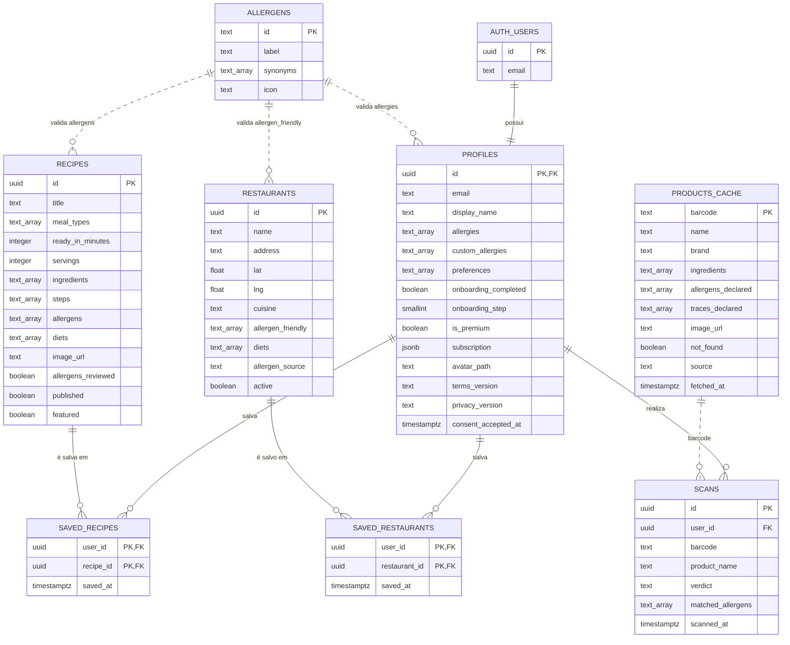

# Banco de Dados – Allivia

**Instituição:** Etec de Taboão da Serra
**Integrantes:** Lavínia Manzan, Mirella Ferreira, Rihana Ferreira, Sophia Félix e Vicente da Silva

---

## 1 Visão geral

O Allivia usa o **Supabase**, que oferece um banco **PostgreSQL** gerenciado, autenticação (**Supabase Auth**) e armazenamento de arquivos (**Storage**). O banco possui 8 tabelas no esquema `public`, regras de acesso por linha (**RLS**) em todas elas, gatilhos de validação e funções SQL.

- **Convenção de nomes:** tabelas e colunas em `snake_case` no banco; campos em `camelCase` no TypeScript. A conversão acontece somente na camada `src/services/`.
- **Datas:** preenchidas pelo próprio banco (`now()`).
- **Chave de acesso:** o aplicativo usa somente a chave pública (anon). A chave administrativa (`service_role`) nunca entra no aplicativo nem no repositório.

## 2 Diagrama entidade-relacionamento

*Figura 1 – Diagrama entidade-relacionamento. Linhas tracejadas indicam relação lógica validada por gatilho ou por chave de texto, sem chave estrangeira. Fonte: autoria própria (2026).*

## 3 Dicionário de dados

### 3.1 `allergens` – catálogo de alergênicos

Catálogo fixo com os 8 alergênicos usados em todo o sistema.

| Coluna | Tipo | Restrições | Descrição |
| --- | --- | --- | --- |
| `id` | text | PK | Identificador fixo: `milk`, `egg`, `peanut`, `tree_nuts`, `gluten`, `soy`, `fish`, `shellfish` |
| `label` | text | not null | Rótulo exibido: Leite, Ovo, Amendoim, Castanhas, Glúten, Soja, Peixes, Frutos do mar |
| `synonyms` | text[] | not null | Termos equivalentes usados na busca (ex.: manteiga, queijo, soro de leite para Leite) |
| `icon` | text | — | Nome do ícone |

### 3.2 `profiles` – perfil do usuário

Um registro por usuário do Supabase Auth.

| Coluna | Tipo | Restrições | Descrição |
| --- | --- | --- | --- |
| `id` | uuid | PK, FK → `auth.users`, cascata | Mesmo ID do usuário autenticado |
| `email` | text | not null | E-mail da conta |
| `display_name` | text | not null | Nome ou apelido |
| `allergies` | text[] | IDs do catálogo (gatilho) | Alergias selecionadas |
| `custom_allergies` | text[] | — | Até 5 alergias digitadas pelo usuário |
| `preferences` | text[] | `lactose_free`, `gluten_free`, `vegetarian`, `vegan` | Preferências alimentares |
| `onboarding_completed` | boolean | default false | Indica se o cadastro de preferências foi concluído |
| `onboarding_step` | smallint | 0 a 3 | Último passo salvo do onboarding |
| `is_premium` | boolean | default false | Indica assinatura Premium (simulada) |
| `subscription` | jsonb | — | Plano, status, início e renovação da assinatura simulada |
| `avatar_path` | text | — | Caminho da foto no bucket `avatars` |
| `terms_version` | text | not null | Versão dos Termos de Uso aceita |
| `privacy_version` | text | not null | Versão da Política de Privacidade aceita |
| `consent_accepted_at` | timestamptz | not null | Data do aceite |
| `created_at`, `updated_at` | timestamptz | not null | Datas de criação e atualização |

### 3.3 `recipes` – receitas próprias

| Coluna | Tipo | Restrições | Descrição |
| --- | --- | --- | --- |
| `id` | uuid | PK | Identificador |
| `title` | text | not null | Nome da receita |
| `description`, `tip` | text | — | Descrição e dica |
| `image_url` | text | — | Foto (bucket público `recipe-images`) |
| `meal_types` | text[] | `breakfast`, `lunch`, `dinner`, `snack`, `dessert` | Tipos de refeição |
| `ready_in_minutes` | integer | > 0 | Tempo de preparo |
| `servings`, `yield_label` | integer, text | `servings` > 0 | Porções e rendimento |
| `ingredients` | text[] | ao menos 1 | Ingredientes |
| `steps` | text[] | ao menos 1 | Modo de preparo |
| `allergens` | text[] | IDs do catálogo (gatilho) | Alergênicos presentes |
| `diets` | text[] | mesmas opções de `preferences` | Dietas atendidas |
| `calories_kcal`, `protein_g`, `carbs_g`, `fat_g` | numérico | ≥ 0 | Informação nutricional (opcional) |
| `allergens_reviewed` | boolean | default false | Alergênicos revisados pela equipe |
| `published` | boolean | exige revisão | Receita visível no aplicativo |
| `featured` | boolean | default false | Receita em destaque na Home |
| `source_key`, `source_reference` | text | `source_key` único | Chave e origem da importação |

Restrições de coerência: receita "sem glúten" não pode conter glúten; "vegana" não pode conter leite, ovo, peixes ou frutos do mar; "vegetariana" não pode conter peixes ou frutos do mar; só é publicada com `allergens_reviewed = true`.

### 3.4 `saved_recipes` – receitas favoritas

| Coluna | Tipo | Restrições | Descrição |
| --- | --- | --- | --- |
| `user_id` | uuid | PK, FK → `profiles`, cascata | Usuário |
| `recipe_id` | uuid | PK, FK → `recipes`, cascata | Receita |
| `saved_at` | timestamptz | not null | Data em que foi salva |

### 3.5 `restaurants` – restaurantes cadastrados pela equipe

| Coluna | Tipo | Restrições | Descrição |
| --- | --- | --- | --- |
| `id` | uuid | PK | Identificador |
| `name`, `address` | text | not null | Nome e endereço |
| `lat`, `lng` | double precision | preenchidos em par; faixas válidas | Coordenadas (opcionais) |
| `cuisine` | text | `healthy`, `vegetarian`, `snacks`, `other` | Categoria |
| `allergen_friendly` | text[] | IDs do catálogo (gatilho) | Alergias que o restaurante declara atender |
| `diets` | text[] | mesmas opções de `preferences` | Dietas atendidas |
| `rating` | numeric(2,1) | 0 a 5 | Nota |
| `image`, `description`, `phone` | text | — | Foto, descrição e telefone |
| `allergen_source` | text | — | Fonte da informação sobre alergênicos |
| `active` | boolean | default true | Visível no aplicativo |
| `source_key` | text | único | Chave de importação |

### 3.6 `saved_restaurants` – restaurantes favoritos

| Coluna | Tipo | Restrições | Descrição |
| --- | --- | --- | --- |
| `user_id` | uuid | PK, FK → `profiles`, cascata | Usuário |
| `restaurant_id` | uuid | PK, FK → `restaurants`, cascata | Restaurante |
| `saved_at` | timestamptz | not null | Data em que foi salvo |

A localização do usuário nunca é gravada nesta ou em qualquer outra tabela.

### 3.7 `scans` – histórico do scanner

| Coluna | Tipo | Restrições | Descrição |
| --- | --- | --- | --- |
| `id` | uuid | PK | Identificador |
| `user_id` | uuid | FK → `profiles`, cascata | Usuário |
| `barcode` | text | not null | Código de barras lido |
| `product_name` | text | — | Nome do produto |
| `verdict` | text | `safe`, `warning`, `contains`, `not_found` | Resultado da análise |
| `matched_allergens` | text[] | — | Alergênicos do perfil encontrados |
| `scanned_at` | timestamptz | not null | Data da leitura |

### 3.8 `products_cache` – cache de produtos

| Coluna | Tipo | Restrições | Descrição |
| --- | --- | --- | --- |
| `barcode` | text | PK | Código de barras |
| `name`, `brand`, `category` | text | — | Dados do produto |
| `ingredients`, `ingredients_text` | text[], text | — | Ingredientes em lista e em texto |
| `allergens_declared`, `traces_declared` | text[] | — | Alérgenos e traços declarados |
| `image_url` | text | — | Foto do produto |
| `not_found` | boolean | default false | Produto ausente na fonte |
| `source` | text | not null | Fonte dos dados (Open Food Facts) |
| `fetched_at` | timestamptz | not null | Data da consulta; validade de 30 dias (24 horas se não encontrado) |

## 4 Regras de acesso (RLS)

Todas as tabelas têm RLS ativado. Usuários sem sessão não acessam nenhuma tabela.

| Tabela | Leitura | Escrita |
| --- | --- | --- |
| `allergens` | Usuários autenticados | Somente pelo painel do Supabase |
| `profiles` | Somente o próprio usuário | Somente o próprio usuário |
| `recipes` | Autenticados; apenas receitas publicadas, revisadas **e compatíveis com o perfil** (política restritiva) | Somente pelo painel ou scripts administrativos |
| `saved_recipes` | Somente o próprio usuário | Somente o próprio usuário, e apenas para receitas visíveis a ele |
| `restaurants` | Usuários autenticados; apenas ativos | Somente pelo painel ou scripts administrativos |
| `saved_restaurants` | Somente o próprio usuário | Somente o próprio usuário |
| `scans` | Somente o próprio usuário | Somente o próprio usuário |
| `products_cache` | Usuários autenticados | Inserção e atualização por autenticados; sem exclusão |

**Storage:** o bucket `recipe-images` é público e somente leitura para o aplicativo; o bucket `avatars` é privado (JPEG ou PNG, até 5 MB), e cada usuário só acessa a pasta com o próprio ID.

## 5 Funções e gatilhos

| Nome | Tipo | Finalidade |
| --- | --- | --- |
| `search_recipes(p_meal_type, p_min_minutes, p_max_minutes, p_diets, p_include, p_exclude, p_limit, p_offset)` | Função | Busca paginada de receitas; lê o perfil de quem chama e exclui receitas com seus alergênicos, sinônimos e alergias personalizadas; aceita filtros de refeição, tempo, dietas e ingredientes (sem acento) |
| `recipe_matches_profile(p_allergens, p_ingredients)` | Função | Verifica se uma receita é compatível com o perfil; usada pela política restritiva de `recipes` |
| `delete_own_account()` | Função | Apaga o próprio usuário; perfil, favoritos e histórico são apagados em cascata |
| `set_updated_at()` | Gatilho | Atualiza `updated_at` em `profiles` e `recipes` |
| `validate_profile_allergies()` | Gatilho | Recusa IDs de alergia fora do catálogo em `profiles` |
| `validate_recipe_allergens()` | Gatilho | Recusa IDs de alergênico fora do catálogo em `recipes` |
| `validate_restaurant_allergens()` | Gatilho | Recusa IDs fora do catálogo em `restaurants` |

## 6 Arquivos do banco

Os arquivos ficam em [`codigo-fonte/supabase/`](../codigo-fonte/supabase/) e são executados manualmente no SQL Editor do Supabase.

| Arquivo | Finalidade |
| --- | --- |
| `schema.sql` | Cria o banco completo do zero (tabelas, RLS, funções, gatilhos e catálogo de alergênicos) |
| `migrations/002_receitas_proprias.sql` | Receitas próprias e função `search_recipes` |
| `migrations/003_scanner.sql` | Campos extras do cache de produtos e veredito "não encontrado" |
| `migrations/004_restaurants.sql` | Restaurantes curados e favoritos |
| `migrations/005_conteudo_pdf.sql` | Pacote gerado com o catálogo atual: 35 receitas e 7 restaurantes; inclui as migrações 006 e 008 |
| `migrations/006_recipe_access_images.sql` | Bloqueio de receitas por alergia também em favoritos e links diretos; bucket de fotos |
| `migrations/007_profile_avatars.sql` | Coluna `avatar_path` e bucket privado `avatars` |
| `migrations/008_remove_recipes_without_photos.sql` | Remove receitas antigas sem foto |
| `migrations/009_remove_frango_com_legumes.sql` | Remove uma receita antiga do catálogo |
| `seed/conteudo-pdf.json` | Fonte do catálogo atual, usada por `npm run gerar:conteudo` |

### 6.1 Instalação em banco novo

1. Executar `schema.sql`.
2. Executar o pacote completo `migrations/005_conteudo_pdf.sql`.
3. Executar `migrations/007_profile_avatars.sql` e `migrations/009_remove_frango_com_legumes.sql`.
4. Conferir o resultado: 35 receitas publicadas, nenhum rascunho e 7 restaurantes.

Em banco existente, execute somente as migrações ainda não aplicadas. **Não** execute novamente `schema.sql` nem a migração 004. Faça backup antes de executar SQL que altera dados. O passo a passo completo está em [`codigo-fonte/supabase/README.md`](../codigo-fonte/supabase/README.md).
