# Manual do Usuário – Allivia

**Instituição:** Etec de Taboão da Serra
**Contato:** alliviafood@gmail.com

---

Bem-vindo ao **Allivia**! Este manual explica, passo a passo, como usar cada função do aplicativo. As capturas das telas estão na pasta [`imagens/telas/`](../imagens/telas/) e o vídeo de demonstração pode ser assistido no [YouTube](https://youtu.be/91AB24_cSzw).

> **Importante:** o Allivia é uma ferramenta de apoio. Ele não substitui a leitura do rótulo nem a orientação de profissionais de saúde. Sempre confira os ingredientes antes de consumir.

## Sumário

1. [Instalação](#1-instalação)
2. [Criar uma conta](#2-criar-uma-conta)
3. [Entrar e recuperar a senha](#3-entrar-e-recuperar-a-senha)
4. [Configurar o perfil alimentar](#4-configurar-o-perfil-alimentar)
5. [Tela inicial e navegação](#5-tela-inicial-e-navegação)
6. [Receitas](#6-receitas)
7. [Scanner de alimentos](#7-scanner-de-alimentos)
8. [Plano Premium](#8-plano-premium)
9. [Restaurantes](#9-restaurantes)
10. [Itens salvos](#10-itens-salvos)
11. [Perfil e conta](#11-perfil-e-conta)
12. [Perguntas frequentes](#12-perguntas-frequentes)

## 1 Instalação

O Allivia funciona em celulares Android e iOS.

- **APK de demonstração (Android):** instale o arquivo fornecido pela equipe. Se o Android pedir, permita a instalação de aplicativos desta fonte.
- **Expo Go (desenvolvimento):** instale o Expo Go na loja do celular e leia o QR code exibido pelo computador da equipe. Computador e celular devem estar na mesma rede Wi-Fi.

É necessário estar conectado à internet para usar o aplicativo.

## 2 Criar uma conta

1. Abra o aplicativo. Após a tela de abertura, aparece a tela **"Seja bem vindo!"**.
2. Toque em **Cadastre-se**.
3. Preencha **e-mail**, **senha** e **confirmação da senha**. A senha deve ter **pelo menos 8 caracteres, com letras e números**.
4. Marque as duas caixas de aceite: **Termos de uso** e **Política de Privacidade**. Toque nos nomes para ler os textos completos.
5. Toque em **Criar conta**.
6. Você receberá no e-mail um **código de 6 dígitos**. Digite-o na tela de verificação.
   - Se o código não chegar, confira a caixa de spam. Você pode pedir um novo código após **60 segundos**.
   - Código errado ou expirado mostra a mensagem "Código inválido ou expirado".

## 3 Entrar e recuperar a senha

### 3.1 Entrar

1. Na tela de boas-vindas, toque em **Fazer Login**.
2. Digite e-mail e senha e toque em **Entrar**.
3. Se os dados estiverem incorretos, aparece a mensagem "E-mail ou senha incorretos."

Depois do primeiro acesso, o aplicativo mantém você conectado, mesmo ao fechá-lo.

### 3.2 Esqueci minha senha

1. Na tela de login, toque em **Recuperar senha**.
2. Informe o e-mail da conta e toque em **Enviar código**. Você receberá um **código de 6 dígitos**.
3. Digite o código e, em seguida, a **nova senha** e a **confirmação**. As duas precisam ser iguais.
4. A nova senha só é gravada depois que o código é confirmado.

## 4 Configurar o perfil alimentar

Na primeira vez que entrar, o aplicativo pede três informações. Cada passo é salvo: se você fechar o aplicativo, ele retoma de onde parou.

**Passo 1 – Como podemos chamar você?**
Digite seu nome ou apelido (2 a 30 caracteres; letras, espaços, hífen e apóstrofo).

**Passo 2 – Quais alergias você possui?**
- Toque nas alergias que se aplicam a você: **Leite, Ovo, Amendoim, Castanhas, Glúten, Soja, Peixes e Frutos do mar**. Toque de novo para desmarcar.
- Para outra alergia, toque em **Adicionar outra alergia** e digite o nome (por exemplo, "mostarda"). É possível adicionar até **5 alergias personalizadas**, sem repetições.

**Passo 3 – Alguma restrição ou preferência?**
Escolha **Sem lactose**, **Sem glúten**, **Vegetariana**, **Vegana** ou **Nenhuma** e toque em **Concluir**.

**Permissões**
Por fim, o aplicativo explica por que usa a **câmera** (para ler códigos de barras) e a **localização** (para encontrar restaurantes perto de você). Você pode permitir agora ou depois.

## 5 Tela inicial e navegação

A barra inferior tem cinco abas:

| Aba | Para que serve |
| --- | --- |
| **Início** | Atalho para o scanner, suas restrições, receitas sugeridas, restaurantes próximos e itens salvos |
| **Receitas** | Lista de receitas compatíveis com o seu perfil |
| **Scanner** | Leitura de códigos de barras e histórico de produtos (Premium) |
| **Restaurantes** | Lista e mapa de restaurantes que atendem às suas restrições |
| **Perfil** | Seus dados, restrições, documentos e opções da conta |

Se a internet cair, o aplicativo mostra uma mensagem e o botão **Tentar novamente**.

  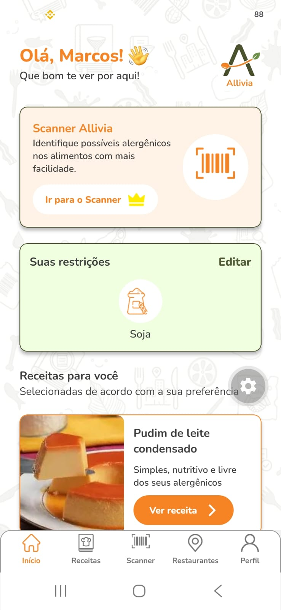
  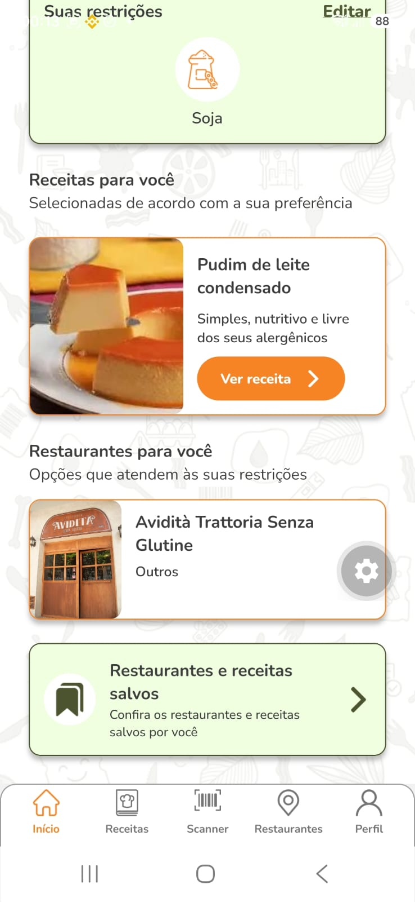

*Figura 1 – Tela inicial. Fonte: autoria própria (2026).*

## 6 Receitas

### 6.1 Ver receitas

Abra a aba **Receitas**. A lista já **exclui** as receitas que contêm suas alergias, incluindo ingredientes equivalentes (por exemplo, manteiga e queijo para quem tem alergia a leite). Role a tela para carregar mais receitas.

### 6.2 Filtrar

Toque no ícone de **filtro** e escolha:

- **Refeição:** café da manhã, almoço, jantar, lanche ou sobremesa;
- **Tempo de preparo**;
- **Dieta:** suas preferências já aparecem marcadas;
- **Ingredientes:** inclua os que deseja ou exclua os que não quer (até 5).

Toque em **Aplicar** para ver o resultado.

  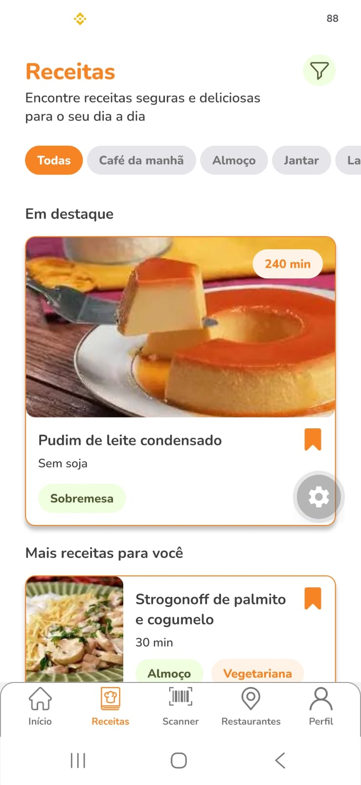
  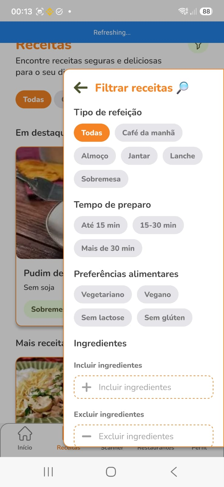
  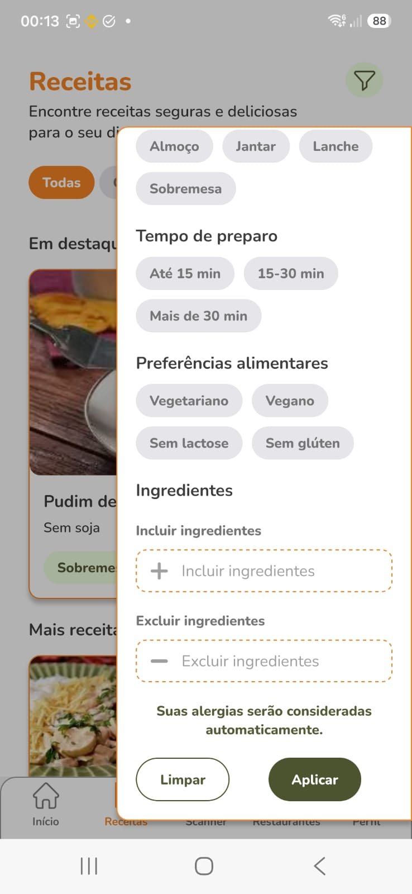

*Figura 2 – Receitas e filtros. Fonte: autoria própria (2026).*

### 6.3 Abrir uma receita

Toque em uma receita para ver a foto, o rendimento, o tempo de preparo, os ingredientes, o modo de preparo e a dica. O aviso de segurança aparece no topo: confira sempre os rótulos dos ingredientes que você usar.

### 6.4 Salvar

Toque no ícone de **marcador** para salvar ou remover a receita dos seus salvos.

## 7 Scanner de alimentos

O scanner é um recurso **Premium** (veja a seção 8).

### 7.1 Ler um código de barras

1. Abra a aba **Scanner** (ou toque em **Ir para o Scanner** na tela inicial) e toque para escanear.
2. Na primeira vez, permita o acesso à **câmera**.
3. Aponte a câmera para o código de barras, no centro da tela e em local bem iluminado. Use o botão de **lanterna**, se necessário.
4. O celular vibra ao ler o código e o aplicativo mostra a análise.

### 7.2 Digitar o código

Se a câmera não funcionar ou não estiver autorizada, toque em **Digitar código manualmente**, informe os números do código (8 a 14 dígitos) e toque em **Analisar**.

### 7.3 Entender o resultado

| Resultado | O que significa |
| --- | --- |
| **Contém restrições** | Algum alergênico do seu perfil aparece nos ingredientes. Não consuma. |
| **Atenção** | O produto pode conter traços, os dados estão incompletos ou há uma alergia personalizada para conferir. Leia o rótulo. |
| **Sem alertas identificados** | Nenhum alergênico do seu perfil foi encontrado nos ingredientes informados. Ainda assim, confira o rótulo. |
| **Produto não encontrado** | O produto não está na base de dados. Leia o rótulo da embalagem. |

A tela também mostra a foto, a categoria, o fabricante e a lista de ingredientes do produto.

  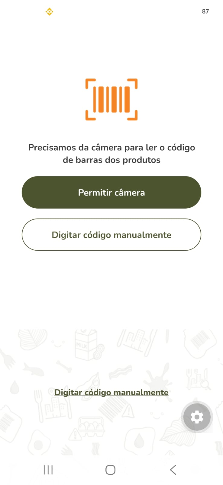
  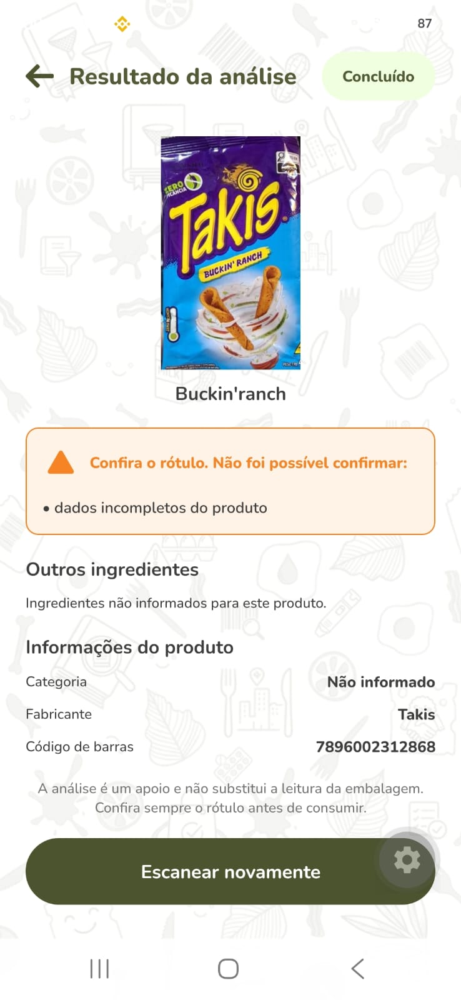

*Figura 3 – Permissão da câmera e resultado da análise. Fonte: autoria própria (2026).*

### 7.4 Histórico

A aba **Scanner** lista os produtos que você já escaneou, com foto e resultado. Se você escanear de novo o mesmo produto, ele volta para o topo da lista, sem repetição.

  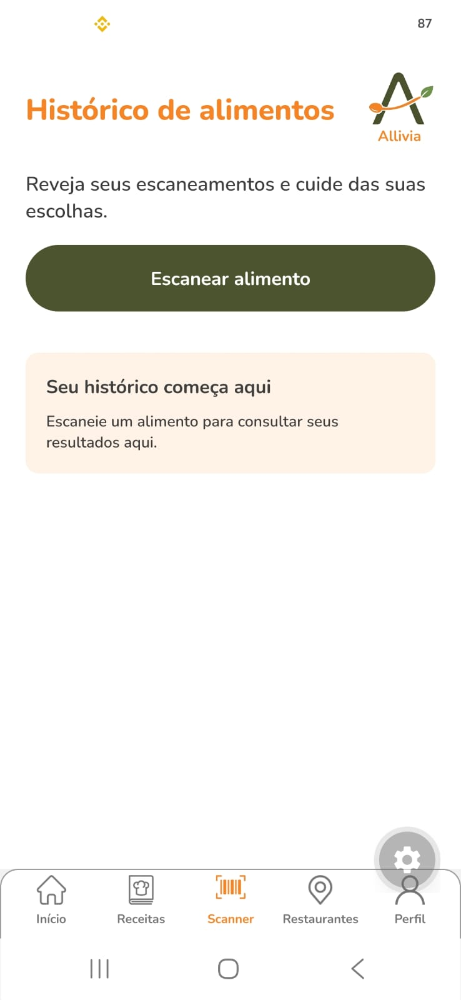
  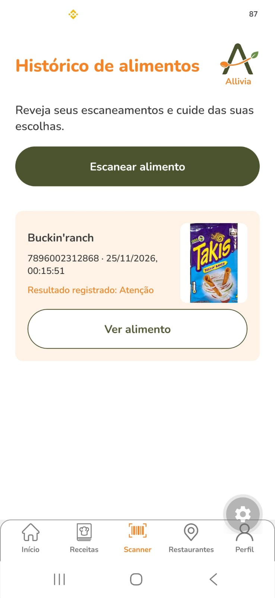

*Figura 4 – Histórico de alimentos. Fonte: autoria própria (2026).*

## 8 Plano Premium

> **Ambiente de demonstração:** o pagamento é simulado. Nenhuma cobrança é feita. **Não digite dados reais de cartão.**

1. Abra a aba **Scanner**. Se você ainda não for Premium, aparece a apresentação do **Scanner Allivia**.
2. Escolha o plano:
   - **Plano Anual:** R$ 149,90/ano (aprox. R$ 12,50/mês);
   - **Plano Mensal:** R$ 14,90/mês.
3. Toque em **Continuar** e escolha a forma de pagamento: **cartão de crédito**, **Pix** ou **cartão de débito**.
4. Toque em **Confirmar assinatura**. Aparece a tela **"Scanner desbloqueado!"**.

O estado da assinatura aparece no seu perfil.

  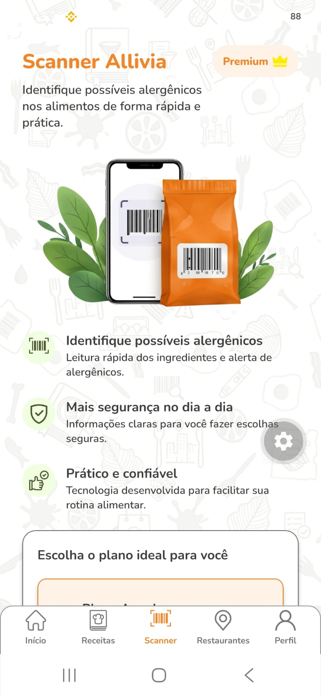
  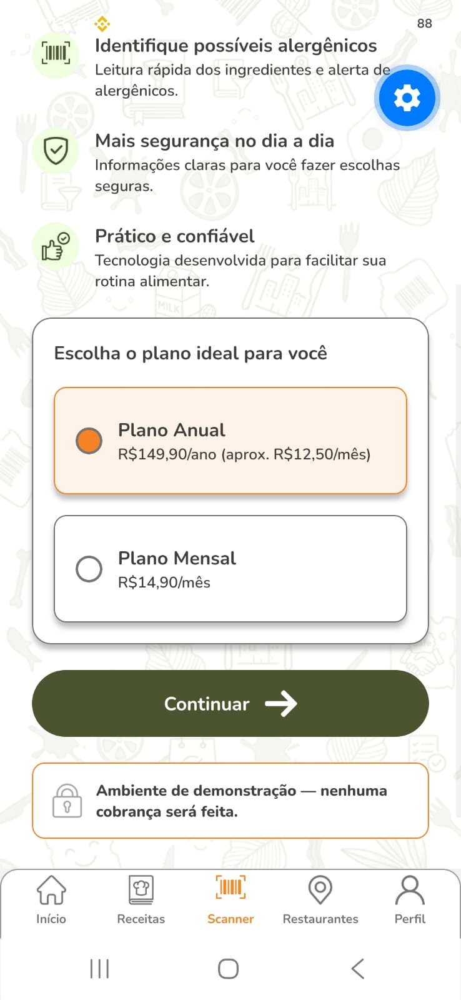
  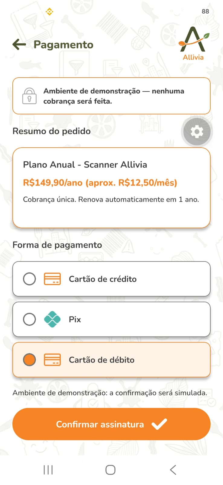
  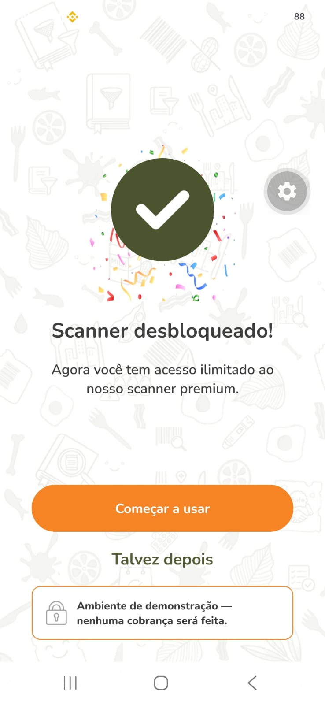

*Figura 5 – Adesão ao Premium (simulada). Fonte: autoria própria (2026).*

## 9 Restaurantes

### 9.1 Escolher a localização

1. Abra a aba **Restaurantes** e toque em **Escolher endereço**.
2. Toque em **Usar minha localização atual** (permita o acesso à localização) ou digite um **endereço com número** e toque em buscar.

Sua localização é usada **somente no celular** para calcular as distâncias; ela não é gravada.

### 9.2 Encontrar restaurantes

- A lista mostra os restaurantes em até **15 km**, ordenados pela distância e pelas suas restrições.
- Use a **busca** para procurar pelo nome ou pela culinária.
- Filtre por categoria: **Todos, Saudáveis, Vegetariano, Lanches e Outros**.
- O **mapa** mostra a sua posição e os restaurantes próximos.

Se nenhum restaurante atender a todas as suas restrições, o aplicativo mostra os mais próximos e avisa que são uma aproximação.

  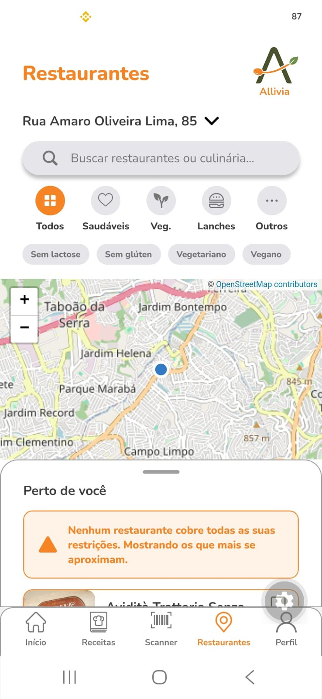

*Figura 6 – Restaurantes. Fonte: autoria própria (2026).*

### 9.3 Detalhes e rota

Toque em um restaurante para ver as fotos, o endereço e as opções sem os seus alergênicos. Toque em **Abrir rota no Google Maps** para ir até o local e no ícone de **marcador** para salvá-lo.

> Confirme sempre as informações sobre alergênicos e contaminação cruzada diretamente com o restaurante.

  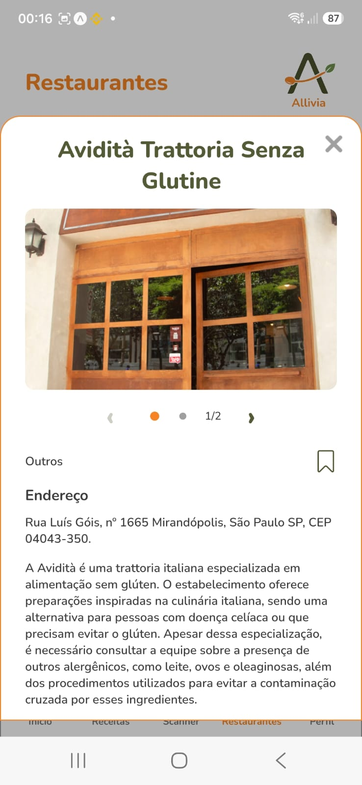

*Figura 7 – Detalhes do restaurante. Fonte: autoria própria (2026).*

## 10 Itens salvos

Na tela **Início**, toque em **Restaurantes e receitas salvos** para ver tudo o que você salvou. Receitas que deixarem de ser compatíveis com o seu perfil ficam ocultas, mas não são apagadas.

## 11 Perfil e conta

Abra a aba **Perfil**.

| Opção | Como usar |
| --- | --- |
| **Editar** | Altere nome, foto, e-mail ou senha. Para trocar e-mail ou senha, confirme a senha atual. A troca de senha é confirmada com um código enviado por e-mail; a troca de e-mail é confirmada pelo link enviado ao novo endereço. |
| **Restrições e preferências** | Marque ou desmarque alergias e preferências e toque em **Salvar**. Se sair sem salvar, o aplicativo pergunta se deseja descartar as alterações. |
| **Ajuda e suporte** | Contato da equipe: alliviafood@gmail.com |
| **Termos de uso** e **Privacidade e Segurança** | Textos legais do aplicativo |
| **Sair da conta** | Encerra a sessão e volta à tela inicial |
| **Excluir conta** | Confirme a exclusão e digite sua senha. Seu perfil, favoritos e histórico são apagados. **Esta ação não pode ser desfeita.** |

  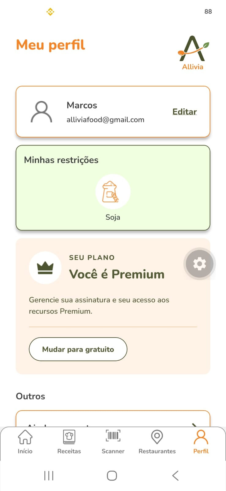
  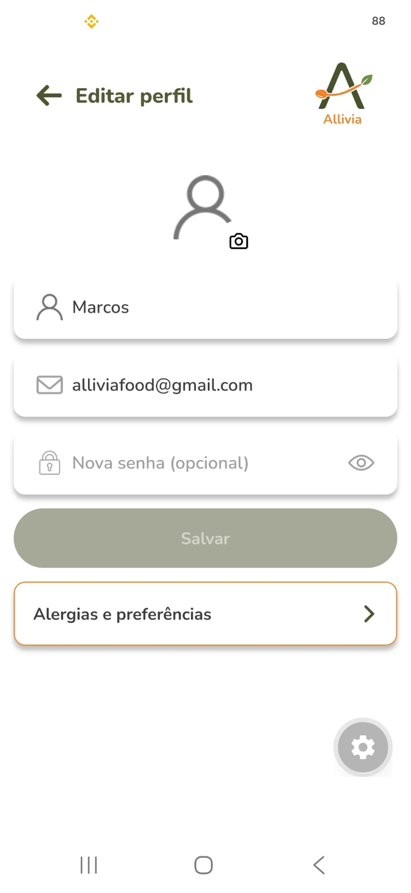

*Figura 8 – Perfil e edição. Fonte: autoria própria (2026).*

  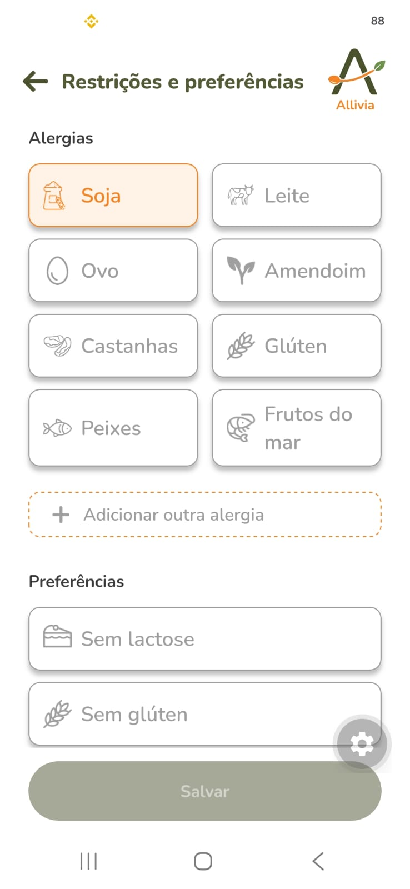
  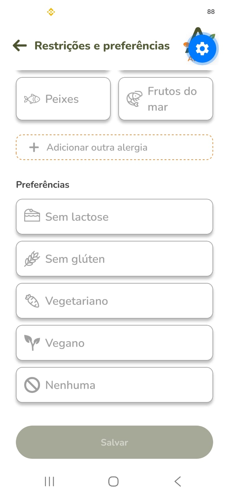

*Figura 9 – Restrições e preferências. Fonte: autoria própria (2026).*

  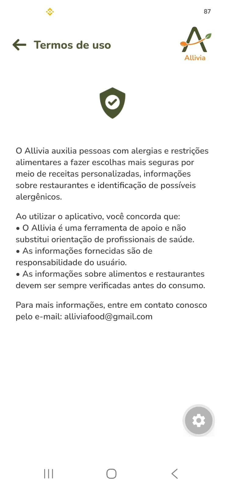
  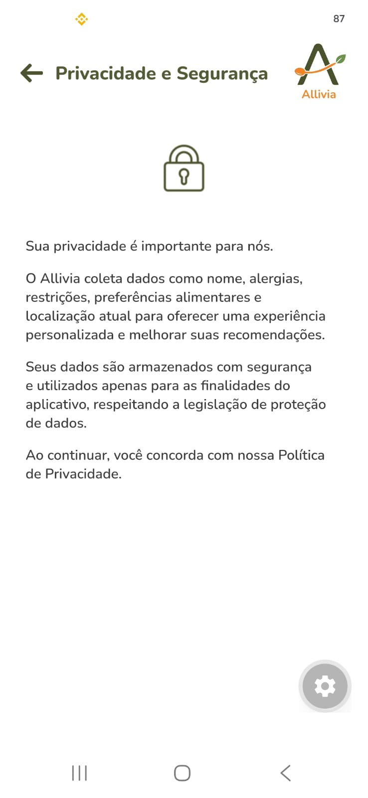
  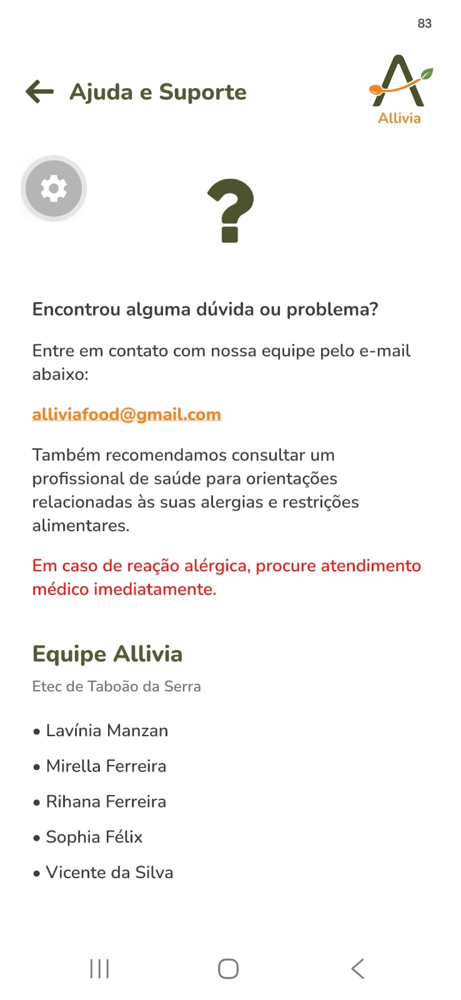

*Figura 10 – Termos, privacidade e ajuda. Fonte: autoria própria (2026).*

  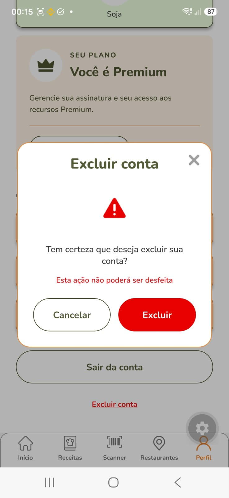

*Figura 11 – Confirmação de exclusão da conta. Fonte: autoria própria (2026).*

## 12 Perguntas frequentes

**O resultado "Sem alertas identificados" garante que o produto é seguro?**
Não. O resultado considera apenas os dados disponíveis na base. Sempre confira o rótulo.

**Por que uma receita não aparece para mim?**
Porque ela contém um alergênico do seu perfil, um ingrediente equivalente ou uma alergia personalizada que você informou.

**O código de verificação não chegou. O que faço?**
Confira a caixa de spam e aguarde 60 segundos para pedir um novo código.

**O mapa demorou para carregar.**
O mapa depende da internet e do servidor público do OpenStreetMap. Aguarde alguns segundos ou use a lista de restaurantes.

**Vou ser cobrado pelo Premium?**
Não. O pagamento é apenas uma demonstração.

**Como falar com a equipe?**
Envie um e-mail para **alliviafood@gmail.com**.
